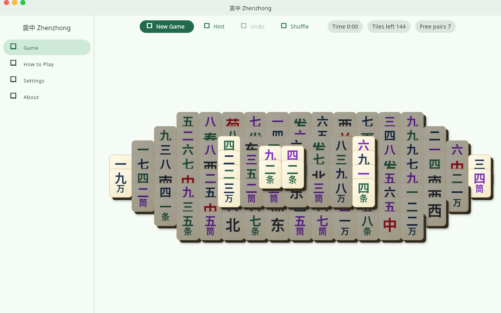
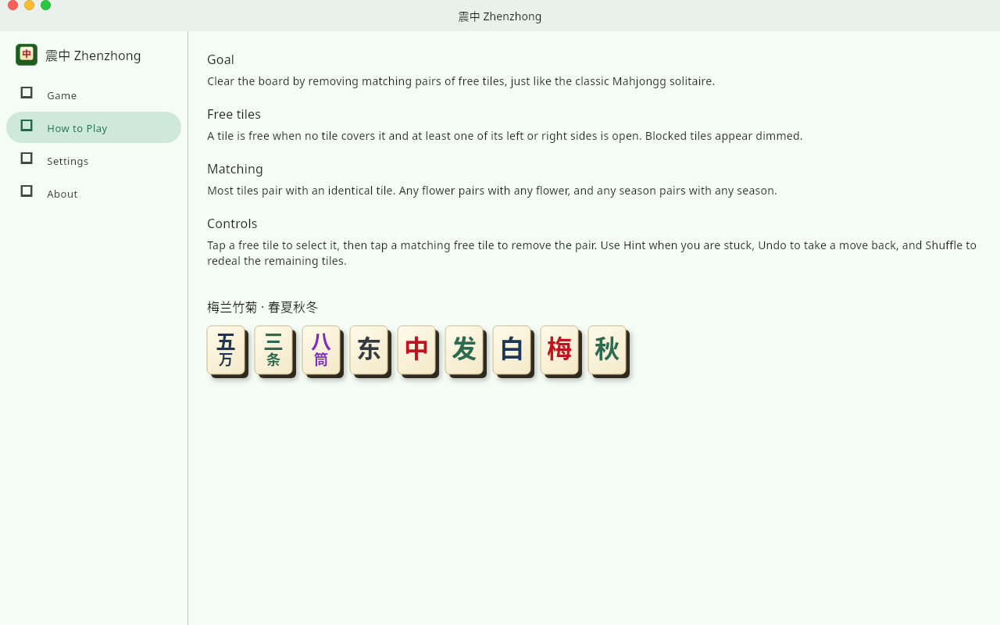
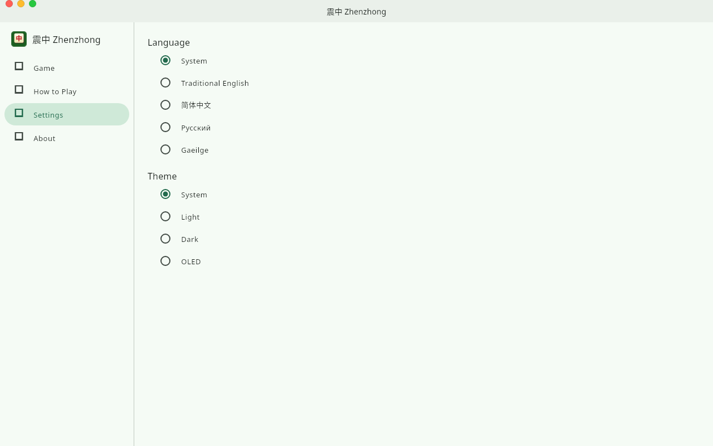

# 震中 Zhenzhong

[](https://gitlab.com/HttpAnimations/zhenzhong/-/pipelines)
[](https://gitlab.com/HttpAnimations/zhenzhong/-/releases)
[](LICENSE)
[](https://httpanimations.gitlab.io/zhenzhong/)

A free and open source Mahjongg solitaire game, in the spirit of KDE's KMahjongg. Clear the board by matching pairs of free tiles, one pair at a time.



## Highlights

- Classic turtle layout with the full 144-tile set: suits, winds, dragons, flowers and seasons
- Tiles are only free when uncovered with an open side, just like the real game
- Hint, undo and shuffle so you never have to rage-quit
- Play on Linux, Windows, macOS, Android, iOS or right in the browser
- Your own language: Traditional English, 简体中文, Русский, Gaeilge
- No ads, no accounts, no tracking. AGPL-3.0

## Play online

- Landing page: https://httpanimations.gitlab.io/zhenzhong/
- Web version: https://httpanimations.gitlab.io/zhenzhong/app/

## Download

Get the latest builds for every platform on the [releases page](https://gitlab.com/HttpAnimations/zhenzhong/-/releases).

### Linux (Flatpak)

```
curl -fLO https://httpanimations.gitlab.io/zhenzhong/flatpak/key.gpg
flatpak remote-add --if-not-exists --gpg-import=key.gpg zhenzhong https://httpanimations.gitlab.io/zhenzhong/flatpak
flatpak install zhenzhong gitlab.httpanimations.zhenzhong
```

Or grab the one-click [zhenzhong.flatpakref](https://httpanimations.gitlab.io/zhenzhong/zhenzhong.flatpakref).

### iOS (AltStore)

Add this source to AltStore:

```
https://gitlab.com/HttpAnimations/zhenzhong/-/raw/main/repos/altstore.json
```

## Screenshots



